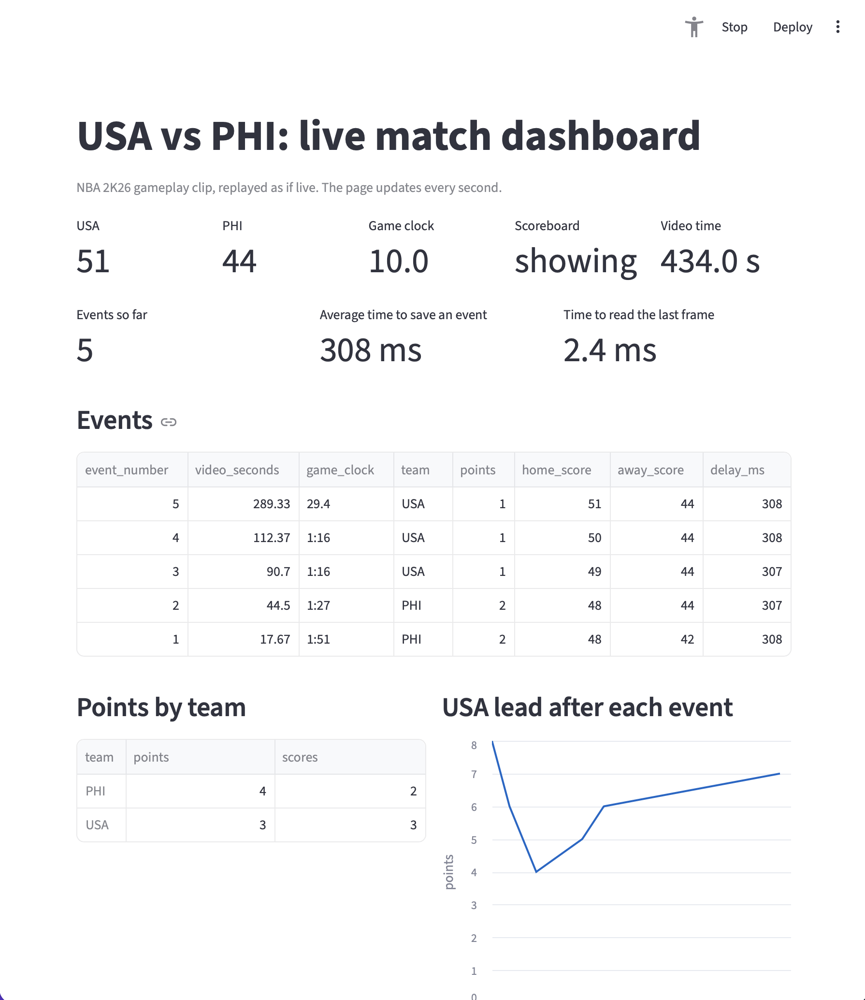

# Live Match Dashboard (NBA 2K)

A live data pipeline for an eSports broadcast. One program watches the game video frame by frame,
detects scoring events from the on-screen scoreboard, and writes them to SQLite the moment they are
confirmed. A Streamlit dashboard reads the database every second and shows the live score, events,
team stats and the lead over time.

Project 2 of my portfolio for the SIS / University of Essex KTP Associate role. It builds on
[Project 1: NBA 2K scoreboard event detection](https://github.com/samueladjei81/nba2k-scoreboard-events),
reusing its scoreboard reader and digit model.

## Results

Measured on an 8-minute NBA 2K26 clip (USA vs Philippines), replayed at normal speed (30 frames per
second) as if it were a live broadcast. The clip came from a public social media post and is not included.

| Measure | Result |
|---|---|
| Scoring events | **5 / 5** correct (same clip as Project 1, checked against the video) |
| Time from new score on screen to saved in the database | **304–310 ms**, average 308 ms |
| Of which: deliberate 10-frame confirmation | ~300 ms |
| Time to read one frame | **2.3–2.4 ms** (budget at 30 fps: 33 ms) |
| Dashboard refresh | every 1 second |
| Largest lead shown | 8 points (correct, including the starting score) |

## How it works

    video ──► live_feed.py ──► live.db (SQLite) ──► dashboard.py (Streamlit)
              plays at real speed       events          refreshes every second
              reads every frame         live_state

1. **`live_feed.py`** plays the video at its real frame rate, reads the scoreboard on every frame with the
   Project 1 reader, confirms a new score after 10 matching frames plus basketball rules (+1, +2 or +3 for
   one team), and saves each event with how long it took. The live score and clock are updated 3 times
   per second. SQLite runs in WAL mode so the dashboard can read while the feed writes.
2. **`dashboard.py`** shows the score, game clock, scoreboard status, events (newest first), points by team,
   and the lead over video time.

## What I learned

- **Warm-up matters for latency.** The first event first took 16.9 s to save, because the model was
  loaded after the live clock had started. Loading it beforehand brought every event to ~308 ms.
- **Test at the speed you claim.** At 4× speed some events lagged by 1–4 s, because each frame then has
  only ~8 ms. At live speed (33 ms per frame) every event was within 304–310 ms.
- **Fixed a Project 1 limitation.** The starting score is now stored, so the largest lead is correct
  (8, not 7).

## Limitations

- Replays a **recorded video file** at live speed. It does not read a real live stream yet.
- Tested on **one clip** with **5 events**.
- The dashboard checks for updates once a second, so a viewer may see an event up to ~1 s after it is saved.
- About 300 ms of each event's delay is the deliberate confirmation wait. Fewer frames would be faster
  but riskier: Project 1 showed scoreboard animations create false readings.
- The delay is measured from the first frame showing the new score, not from the moment the ball went in.
- Only tracks whether the normal scoreboard is **showing or not**. It does not read the timeout banner.
- Rebuilds the database on every run (one match at a time). Team names are set in the code.

## Run it

Needs `scoreboard.py` and `digit_model.joblib` from Project 1 (the model is built by its `train_reader.py`),
and a video at `data/nba2k26.mp4`.

    python -m venv .venv
    source .venv/bin/activate
    pip install -r requirements.txt

    # terminal 1
    streamlit run dashboard.py
    # terminal 2
    python live_feed.py

## Note

Built step by step with guidance from an AI assistant. I wrote and ran every step, checked the results
against the video myself, and can explain each design decision.